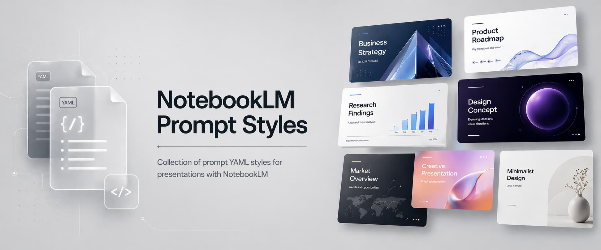

# NotebookLM Slide Styles Collection

A curated collection of visual design styles (YAML) to customize the output of NotebookLM slide generation.

## 🌐 Website

Explore the collection interactively through our high-performance showcase site. Preview styles with rotating thumbnails, copy YAML prompts with a single click, and save your favorites.

- **Live Version:** [View the Showcase](https://www.slidestyleshub.com/)

---

## 📖 Table of Contents

<!-- TOC:START -->
- [👔 Business & Executive](#-business--executive)
  - [Executive Report](#executive-report)
  - [Emerald Corporate](#emerald-corporate)
  - [Vibrant Corporate](#vibrant-corporate)
  - [Ensign Corporate](#ensign-corporate)
  - [Silicon Refined](#silicon-refined)
  - [Liquid Executive](#liquid-executive)
  - [Clinical Precision](#clinical-precision)
  - [Compassion Flat](#compassion-flat)
  - [Urban Barber](#urban-barber)
  - [Strategic Blue](#strategic-blue)
  - [Travel Pulse](#travel-pulse)
  - [Earthy Luxury](#earthy-luxury)
  - [Prestige Gold](#prestige-gold)
  - [Fresh Catering](#fresh-catering)
  - [Commercial Asset](#commercial-asset)
  - [Strategic Insight](#strategic-insight)
  - [Eco Estate](#eco-estate)
  - [Artisanal Brew](#artisanal-brew)
  - [Smart Commerce](#smart-commerce)
  - [Authentic Pasta](#authentic-pasta)
  - [Marine Harvest](#marine-harvest)
- [✨ Minimalist & Modern](#-minimalist--modern)
  - [Geometric Mono](#geometric-mono)
  - [Lush Minimal](#lush-minimal)
  - [Structured Mint](#structured-mint)
  - [Frosted Luxury](#frosted-luxury)
  - [Learning Time](#learning-time)
  - [Slow Living](#slow-living)
  - [Luxe Marble](#luxe-marble)
- [🎨 Creative & Playful](#-creative--playful)
  - [Creative Spark](#creative-spark)
  - [Artisan Rust](#artisan-rust)
  - [Vintage Charm](#vintage-charm)
  - [Creative Notebook](#creative-notebook)
  - [Kawaii Playful](#kawaii-playful)
  - [Y2K Nostalgia](#y2k-nostalgia)
  - [Creative Workshop](#creative-workshop)
  - [Creative Classroom](#creative-classroom)
  - [Hand-Drawn Scrapbook](#hand-drawn-scrapbook)
  - [Whimsical Animation](#whimsical-animation)
  - [Clinical Doodles](#clinical-doodles)
  - [Medicine Pop](#medicine-pop)
  - [Garden Doodles](#garden-doodles)
  - [Kawaii Storybook](#kawaii-storybook)
  - [Biochemical Doodles](#biochemical-doodles)
  - [Science Sketch](#science-sketch)
  - [Athletic Energy](#athletic-energy)
  - [Kawaii Wellness](#kawaii-wellness)
  - [Groovy 70s](#groovy-70s)
  - [Kawaii Pop](#kawaii-pop)
  - [Fandom Noir](#fandom-noir)
  - [Sweet Fandom](#sweet-fandom)
  - [Kawaii Fandom](#kawaii-fandom)
  - [Monster Party](#monster-party)
  - [Mango Kids](#mango-kids)
  - [Street Custom](#street-custom)
  - [Digital Nomad](#digital-nomad)
  - [Engaging Learner](#engaging-learner)
  - [Pop Retro](#pop-retro)
- [📖 Editorial & Magazine](#-editorial--magazine)
  - [Editorial Essence](#editorial-essence)
  - [Luxury Editorial](#luxury-editorial)
  - [Cobalt Editorial](#cobalt-editorial)
  - [Architectural Portfolio](#architectural-portfolio)
  - [Classical Gallery](#classical-gallery)
  - [Summer Collage](#summer-collage)
  - [Vision Board](#vision-board)
  - [Academic Edge](#academic-edge)
  - [Film Scrapbook](#film-scrapbook)
  - [Soft Editorial](#soft-editorial)
  - [Prime Noir](#prime-noir)
- [🚀 Tech & Innovation](#-tech--innovation)
  - [Visual Discovery](#visual-discovery)
  - [Urban Ribbon](#urban-ribbon)
  - [Neon Pulsar](#neon-pulsar)
  - [Midnight Tactical](#midnight-tactical)
  - [Architectural Mono](#architectural-mono)
  - [Architectural Cobalt](#architectural-cobalt)
  - [Startup Aura](#startup-aura)
  - [Neon Venture](#neon-venture)
  - [Cyber Pixel](#cyber-pixel)
  - [Project Launch](#project-launch)
  - [Tech Pitch](#tech-pitch)
  - [Prismatic Tech](#prismatic-tech)
  - [Cyber AI](#cyber-ai)
- [🌿 Nature & Wellness](#-nature--wellness)
  - [Eco Modern](#eco-modern)
  - [Botanical Journal](#botanical-journal)
  - [The Seasons](#the-seasons)
  - [Scholar's Journal](#scholars-journal)
  - [Classical Scrapbook](#classical-scrapbook)
  - [Vibrant Agency](#vibrant-agency)
  - [Vitality Glow](#vitality-glow)
  - [Modern Wellness](#modern-wellness)
  - [Deep Forest](#deep-forest)
  - [Urban Jungle](#urban-jungle)
  - [Modern Farm](#modern-farm)
  - [Sustainable Agri](#sustainable-agri)
  - [Modern Harvest](#modern-harvest)
  - [Mindful Aura](#mindful-aura)
  - [Botanical Harmony](#botanical-harmony)
  - [Yoga Glow](#yoga-glow)
  - [Misty Forest](#misty-forest)
  - [Serum Essence](#serum-essence)
  - [Artisanal Bloom](#artisanal-bloom)
<!-- TOC:END -->
- [🚀 How to Use](#-how-to-use)
- [🛠️ Contribution](#-contribution)
- [🏗️ Acknowledgements](#-acknowledgements)
- [⚖️ Disclaimer](#-disclaimer)

---

## 🎨 Themes

> [!NOTE]
> This list is generated from [`data/catalog.json`](data/catalog.json) and the files in [`styles/`](styles/) (do not edit it by hand; see the [Contribution Guide](CONTRIBUTING.md)). Open the **View Full YAML** link of a style to get its complete configuration (image generation prompts and detailed layouts), or copy it with one click on the [website](https://www.slidestyleshub.com/).

<!-- STYLES:START -->
### 👔 Business & Executive

#### Executive Report

Data-dense, executive style for professional reports. Focuses on statement-driven "Action Titles", rigorous grid structures, and professional high-fidelity visuals.

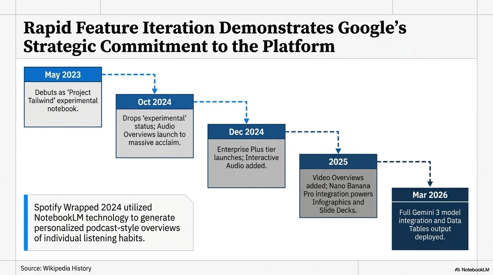

[View Full YAML](styles/executive_report.yaml)

#### Emerald Corporate

A professional, executive-level design featuring a deep forest green palette with sharp crystalline geometric overlays. It uses metallic silver accents and glassmorphic cards to create a high-tech, authoritative corporate atmosphere.

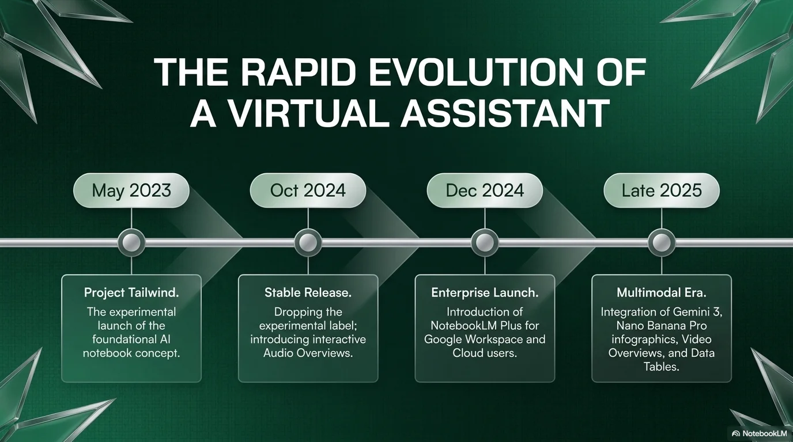

[View Full YAML](styles/emerald_corporate.yaml)

#### Vibrant Corporate

A dynamic, forward-moving corporate aesthetic featuring high-contrast navy blue and vibrant lime green. It uses sharp geometric diagonals, chevron markers, and structured grids to convey professional excellence and modern momentum.

[View Full YAML](styles/vibrant_corporate.yaml)

#### Ensign Corporate

Modern corporate, dynamic, and professional design. Features a strong navy and vivid blue foundation with energetic yellow/orange accents and distinctive corner 'ribbon' layers for a high-impact business presentation.

[View Full YAML](styles/ensign_corporate.yaml)

#### Silicon Refined

Ultra-minimalist, premium, and sleek. Focuses on generous whitespace, precision typography, and high-fidelity visuals. Designed for high-end technology presentations where clarity and elegance are paramount.

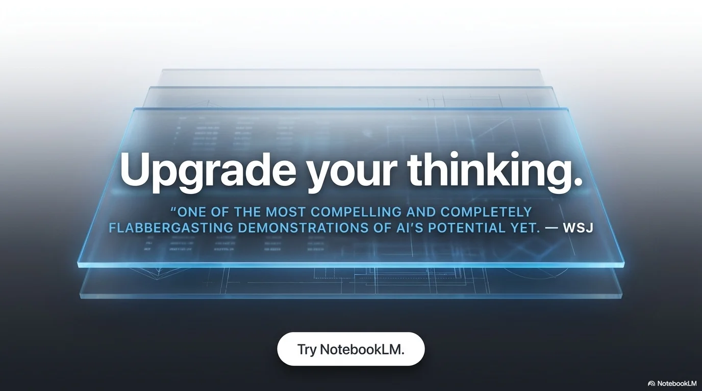

[View Full YAML](styles/silicon_refined.yaml)

#### Liquid Executive

A premium executive aesthetic characterized by flowing blue liquid and smoke textures on a solid black background. It features the elegant Garet typeface and ultra-rounded content containers. Ideal for high-stakes business presentations, corporate reports, and executive portfolios.

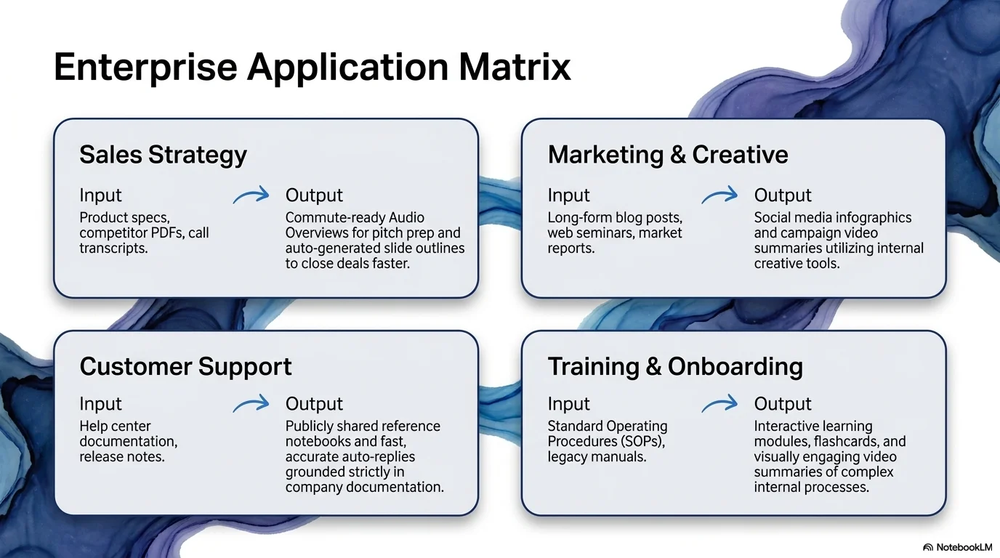

[View Full YAML](styles/liquid_executive.yaml)

#### Clinical Precision

A modern, high-tech medical aesthetic designed for clinical and healthcare presentations. It utilizes the objective Helvetica World typeface, deep black backgrounds, and vibrant blue light glows. Characterized by large typography and sharp minimalist icons, it conveys trust and scientific precision.

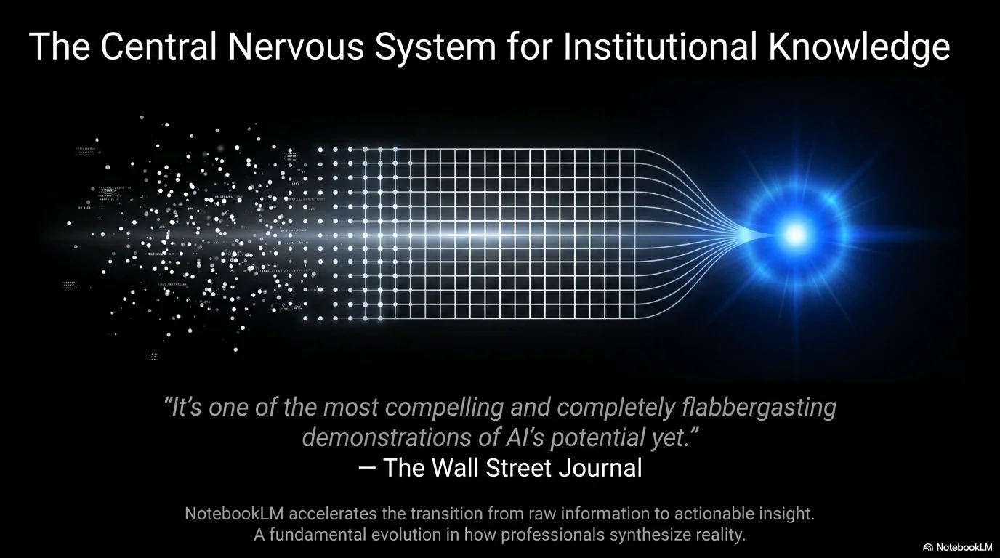

[View Full YAML](styles/clinical_precision.yaml)

#### Compassion Flat

A professional yet warm medical aesthetic utilizing modern flat 2D illustrations. It features the clean Poppins typeface, a serene palette of sky and navy blues, and large symbolic icons like medical crosses and hearts. Organized with rounded containers and soft shadows, it conveys institutional excellence with a human touch.

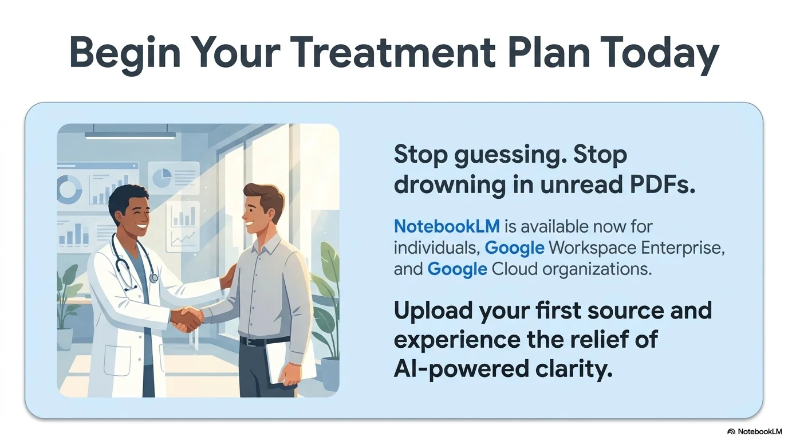

[View Full YAML](styles/compassion_flat.yaml)

#### Urban Barber

A sharp and sophisticated monochromatic aesthetic inspired by modern high-end barbershops. It features the geometric Glacial Indifference for bold, clean headlines and the expressive Bricolage Grotesque for body text. Characterized by a 'Barber Pole Noir' palette of black, white, and steel grey, it uses high-contrast layouts and minimalist razor or comb iconography to create a sense of precision, urban style, and professional grooming excellence.

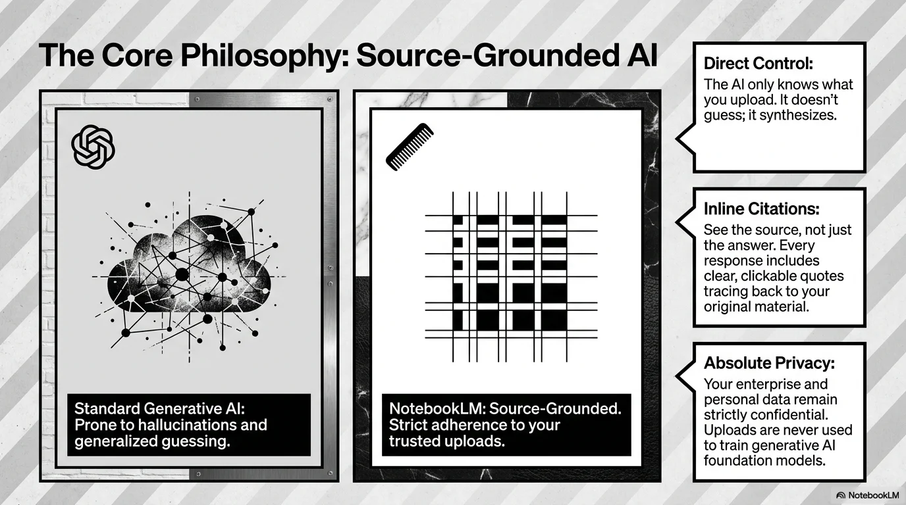

[View Full YAML](styles/urban_barber.yaml)

#### Strategic Blue

A professional and structured corporate aesthetic designed for business proposals, strategic plans, and executive presentations. It features the versatile Montserrat typeface across all hierarchies to ensure maximum clarity and modern authority. Characterized by a palette of deep slate blue, ice blue, and professional grey, it uses subtle hexagonal background patterns, rounded image containers, and pill-shaped call-to-action buttons to create a clean, tech-forward, and trustworthy business presence.

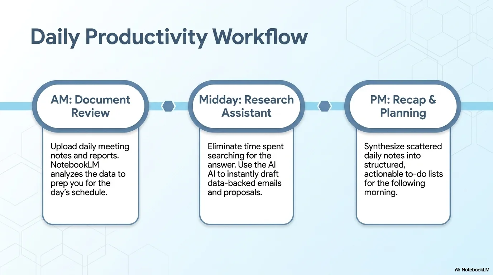

[View Full YAML](styles/strategic_blue.yaml)

#### Travel Pulse

A dynamic and adventurous aesthetic designed for travel agencies, outdoor brands, and tourism portfolios. It utilizes the clean and technical Open Sauce typeface to convey modern reliability and bold exploration. Characterized by a high-contrast palette of charcoal grey, vibrant yellow, and crisp white, it features diagonal striped patterns, dotted airplane path motifs, and circular info badges to create an energetic and motion-focused visual experience.

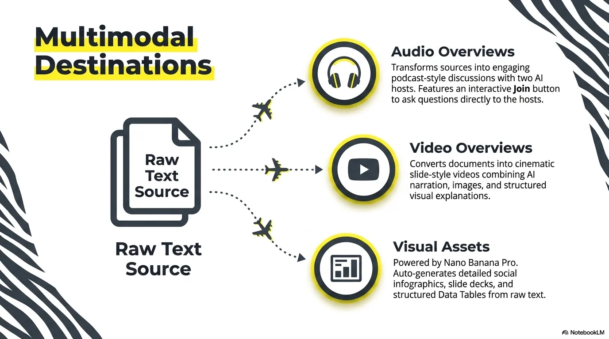

[View Full YAML](styles/travel_pulse.yaml)

#### Earthy Luxury

An earthy and organic hospitality aesthetic designed for boutique hotels, luxury resorts, and Mediterranean-inspired lifestyle brands. It features the clean and balanced Arial Unicode typeface to maintain a modern, uncluttered look that focuses on atmosphere. Characterized by a palette of muted olive green, warm terracotta, and soft cream, it utilizes asymmetrical photo grids with rounded corners, organic line icons, and split-screen layouts to create a serene and high-end experience.

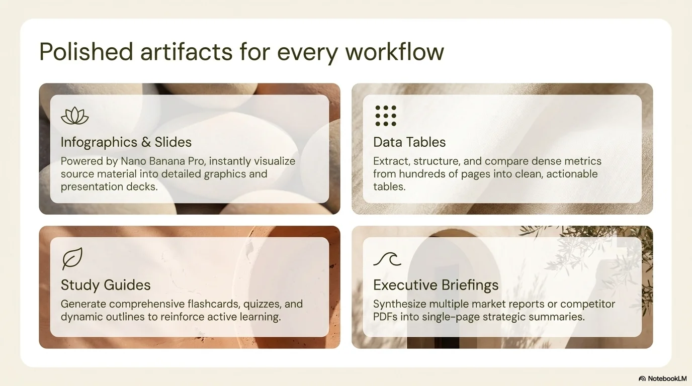

[View Full YAML](styles/earthy_luxury.yaml)

#### Prestige Gold

A prestigious and high-end aesthetic designed for luxury real estate, premium listings, and executive portfolios. It features the elegant Boston Angel serif typeface for headlines, providing a sense of heritage and exclusivity. Characterized by a deep midnight blue background, old gold accents, and warm cream highlights, it utilizes subtle golden light waves, circular prestige icons, and clean architectural lines to create a sophisticated dark-mode experience.

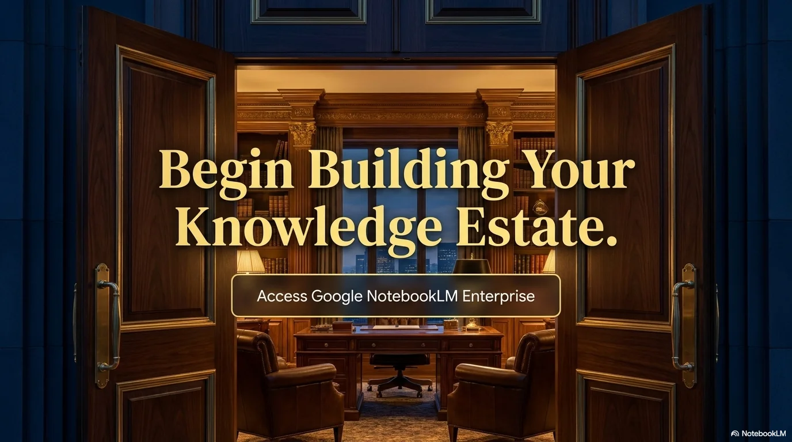

[View Full YAML](styles/prestige_gold.yaml)

#### Fresh Catering

A fresh and modern catering aesthetic designed for food service brands, healthy eating startups, and culinary event portfolios. It utilizes the friendly and geometric Poppins typeface to convey cleanliness and professional reliability. Characterized by a palette of warm cream, orange terracotta, and soft peach, it features large rounded-corner cards, circular background accents, and minimalist geometric markers (+ and x) to create a structured and inviting visual experience.

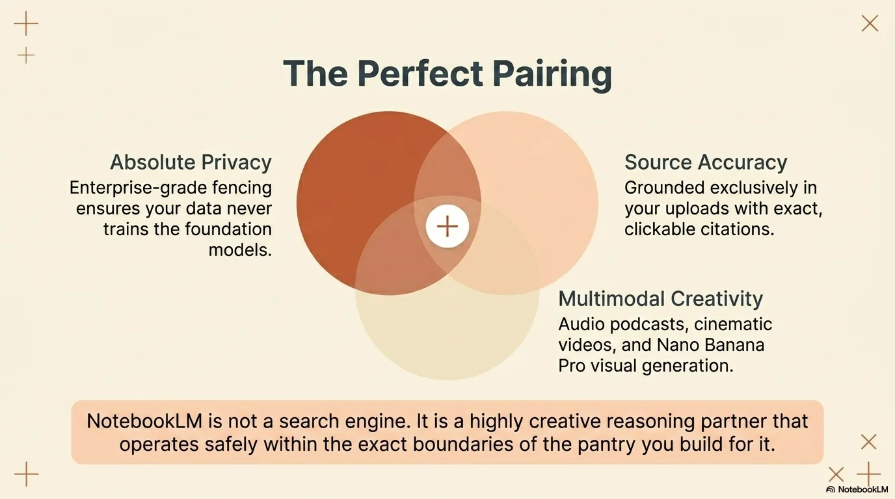

[View Full YAML](styles/fresh_catering.yaml)

#### Commercial Asset

An established and professional aesthetic designed for commercial real estate, investment listings, and corporate property portfolios. It features the classic Times New Roman serif for headings to convey trust and authority, paired with the modern Poppins for body text. Characterized by a palette of deep chocolate brown, sienna orange, and crisp white, it utilizes circular property icons and clean grid layouts to create a sophisticated and reliable investment experience.

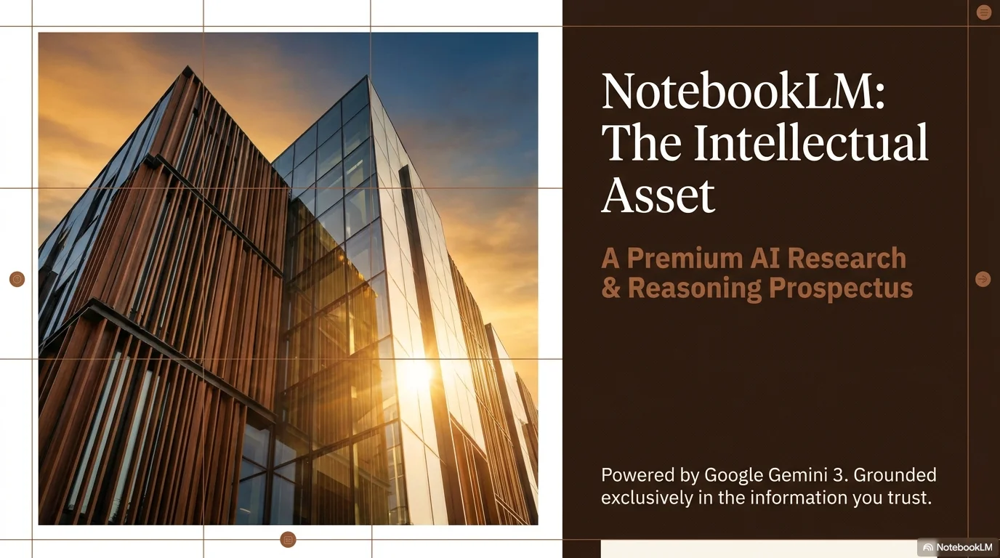

[View Full YAML](styles/commercial_asset.yaml)

#### Strategic Insight

A high-precision and strategic aesthetic designed for luxury market analysis, business consulting, and data-driven strategy presentations. It features the modern and geometric TT Firs Neue typeface to convey technical sophistication and clarity. Characterized by a palette of deep navy blue, crisp white, and cyan accents, it utilizes concentric wave patterns, dot grids, and a signature triple-dot motif in the corners to create a structured and insightful visual experience.

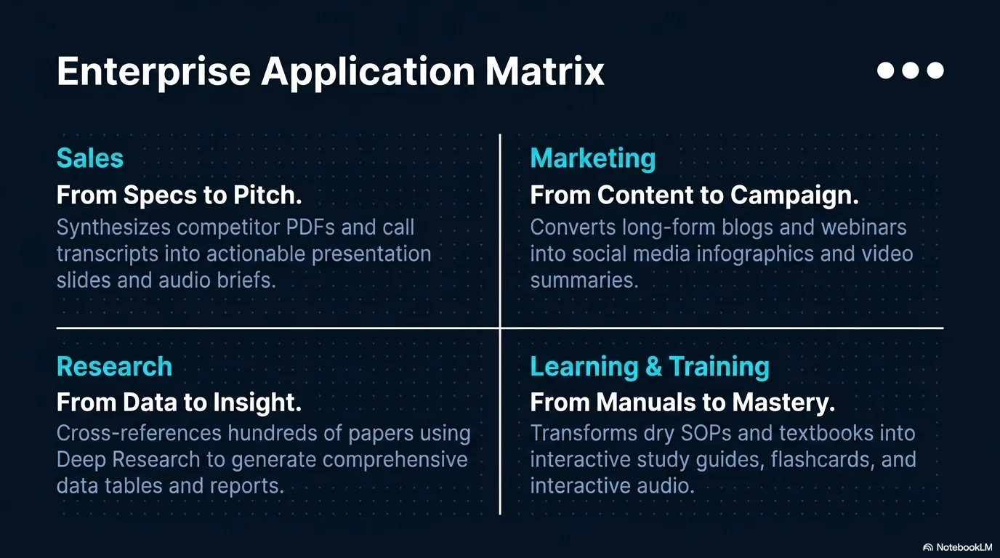

[View Full YAML](styles/strategic_insight.yaml)

#### Eco Estate

A clean and forward-thinking aesthetic designed for sustainable architecture, eco-friendly real estate, and green energy projects. It features the distinctive Prachasong typeface for a modern look, paired with the versatile Poppins. Characterized by a palette of sage green, forest green, and crisp white, it utilizes technical grid patterns, leaf-inspired lightbulb icons, and diagonal growth arrows to create a structured and environmentally conscious visual experience.

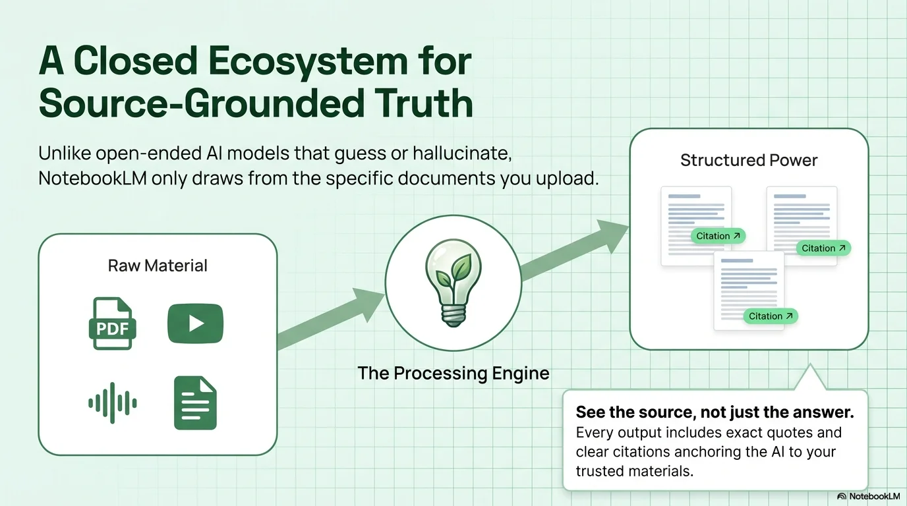

[View Full YAML](styles/eco_estate.yaml)

#### Artisanal Brew

A sophisticated and organic aesthetic designed for premium tea brands, artisanal food experiences, and organic product showcases. It features the powerful Heading Now typeface for titles to convey elegance, paired with the technical clarity of TT Firs Neue. Characterized by a palette of olive green, soft lime, and deep forest black, it utilizes hand-drawn leaf illustrations, organic curved photo containers, and pill-shaped UI elements to create a grounded and premium visual experience.

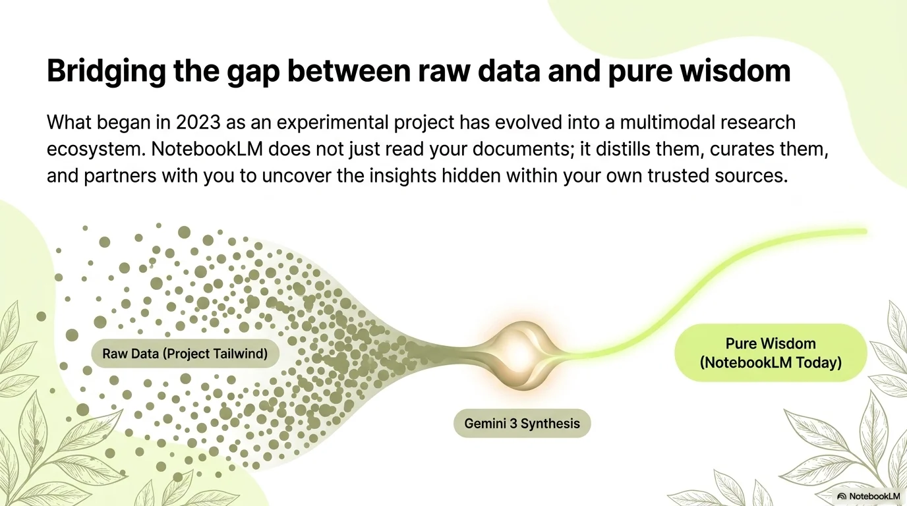

[View Full YAML](styles/artisanal_brew.yaml)

#### Smart Commerce

A smart and innovative aesthetic designed for e-commerce strategies, digital growth agencies, and tech-forward business presentations. It features the powerful Heading Now typeface for titles to convey modern authority, paired with the technical precision of TT Firs Neue. Characterized by a palette of slate grey, soft peach, and mustard yellow, it utilizes abstract geometric shapes, modular grid layouts, and dot patterns to create a structured and innovative visual experience.

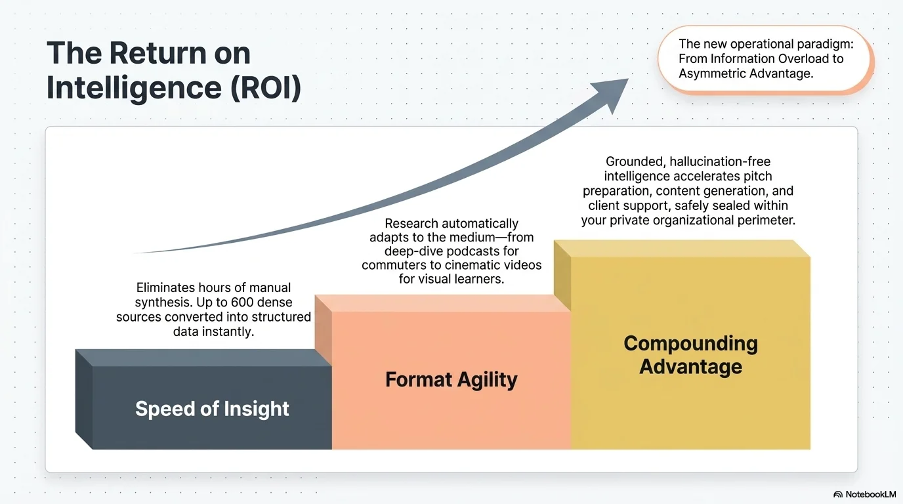

[View Full YAML](styles/smart_commerce.yaml)

#### Authentic Pasta

A rustic and artisanal aesthetic designed for gourmet pasta brands, traditional culinary markets, and premium food industry presentations. It features the bold Heading Now typeface for titles to convey a modern yet traditional feel, paired with the clean TT Firs Neue for body text. Characterized by a palette of terracotta red, dark olive green, and warm cream, it utilizes dark wood textures, hand-drawn botanical illustrations of fresh ingredients (tomatoes, basil, garlic), and circular food badges to create a rich and authentic culinary experience.

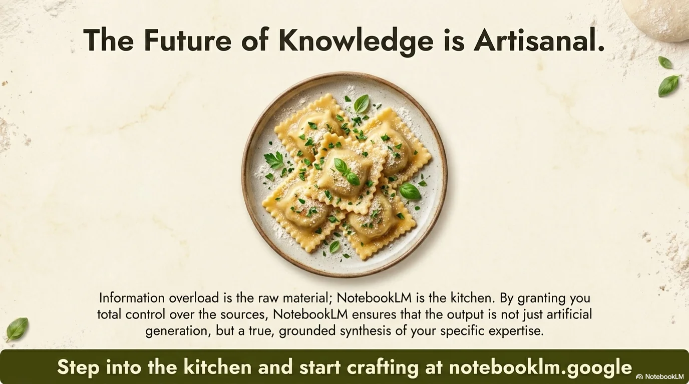

[View Full YAML](styles/authentic_pasta.yaml)

#### Marine Harvest

A professional and marine-inspired aesthetic designed for sustainable seafood brands, ocean conservation projects, and premium seafood industry presentations. It features the wide and modern Agrandir typeface for titles to convey strength and scale, paired with the versatile Poppins for body text. Characterized by a palette of deep ocean blue, bright coral orange, and sandy beige, it utilizes water textures, hand-drawn seafood sketches (lobsters, shrimp, fish), and wavy shapes to create a fresh and trustworthy marine experience.

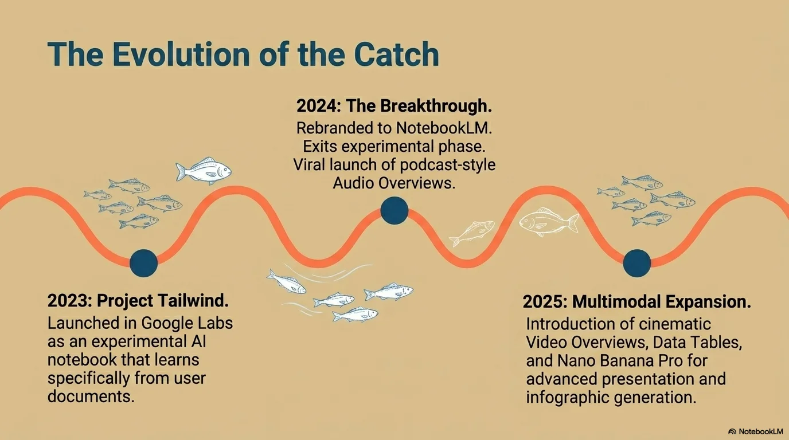

[View Full YAML](styles/marine_harvest.yaml)

### ✨ Minimalist & Modern

#### Geometric Mono

Professional, architectural, and monochromatic design. It uses a strong grayscale palette with geometric shapes and high-contrast photography to convey precision, structure, and corporate excellence.

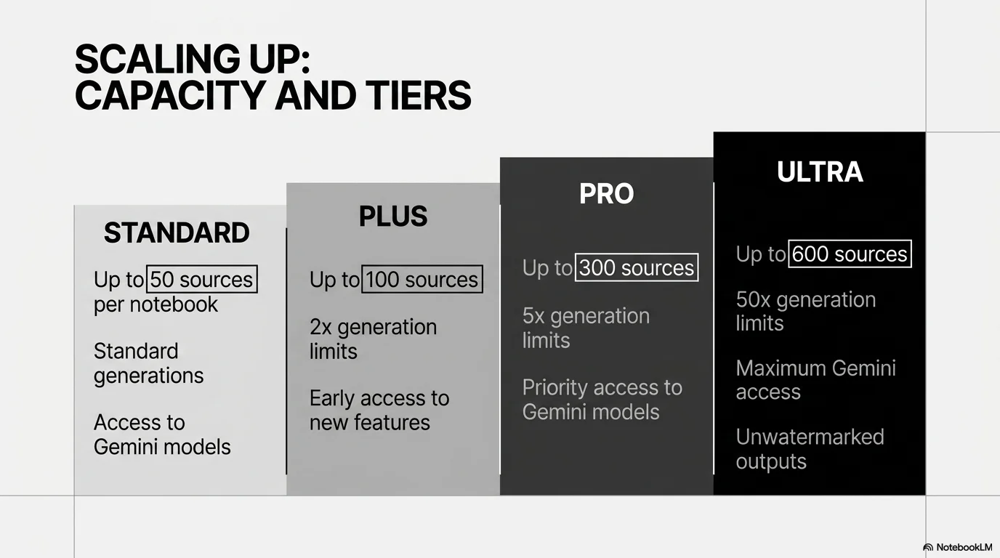

[View Full YAML](styles/geometric_mono.yaml)

#### Lush Minimal

Nature-inspired, organic, and soft design. It focuses on botanical imagery, sage greens, and large rounded corners to create a peaceful yet professional atmosphere.

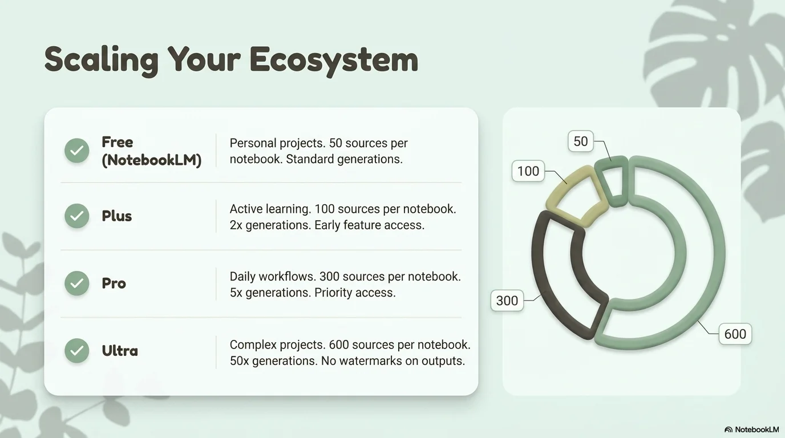

[View Full YAML](styles/lush_minimal.yaml)

#### Structured Mint

Professional, structured, and refreshing corporate design. Features distinctive tiered corner frames in mint green and dark teal, offering a clean and organized frame for business presentations.

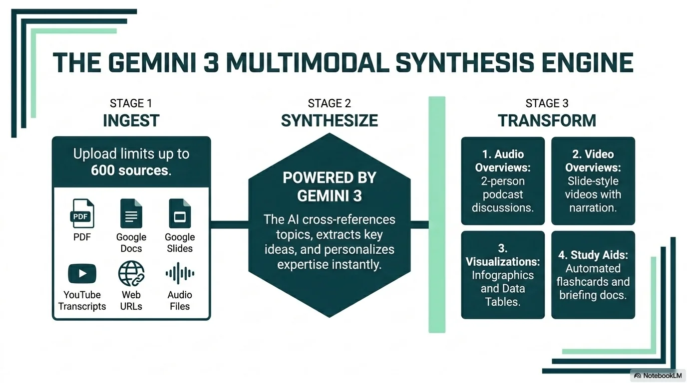

[View Full YAML](styles/structured_mint.yaml)

#### Frosted Luxury

A sophisticated and high-end minimalist aesthetic inspired by luxury fragrance advertising. It features the refined Arial Nova typeface, a warm palette of beige and charcoal, and airy layouts with ample negative space. Characterized by frosted glass effects, high-fashion photography, and elegant thin borders, it conveys exclusivity and timeless elegance.

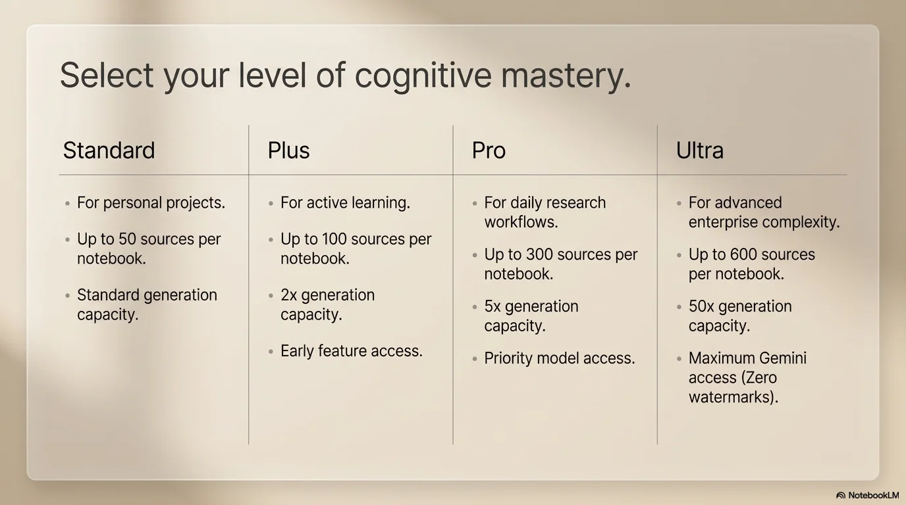

[View Full YAML](styles/frosted_luxury.yaml)

#### Learning Time

A structured and friendly educational aesthetic designed for learning environments, step-by-step guides, and data visualization. It features the soft geometric Aristotelica Pro typeface. Characterized by a palette of sky blue, emerald green, and coral orange on cream backgrounds, it uses grained textures, clock icons, and Venn-diagram-inspired lists to create a clear, professional, and engaging instructional atmosphere.

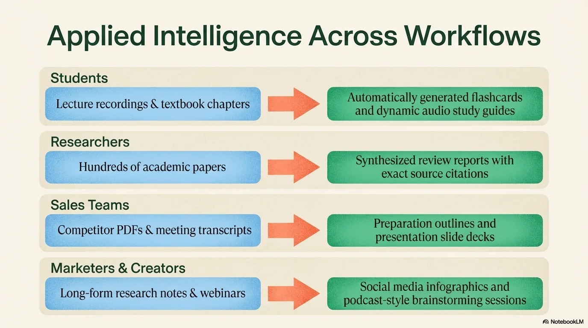

[View Full YAML](styles/learning_time.yaml)

#### Slow Living

A premium and sophisticated aesthetic based on the 'Slow Living' movement. It uses the modern Open Sauce sans-serif to create a minimalist editorial look. Characterized by deep navy blue, pure white, and muted earthy browns, it features high-contrast split-screen layouts and macro photography focus to convey calmness, mindfulness, and a high-end lifestyle vibe.

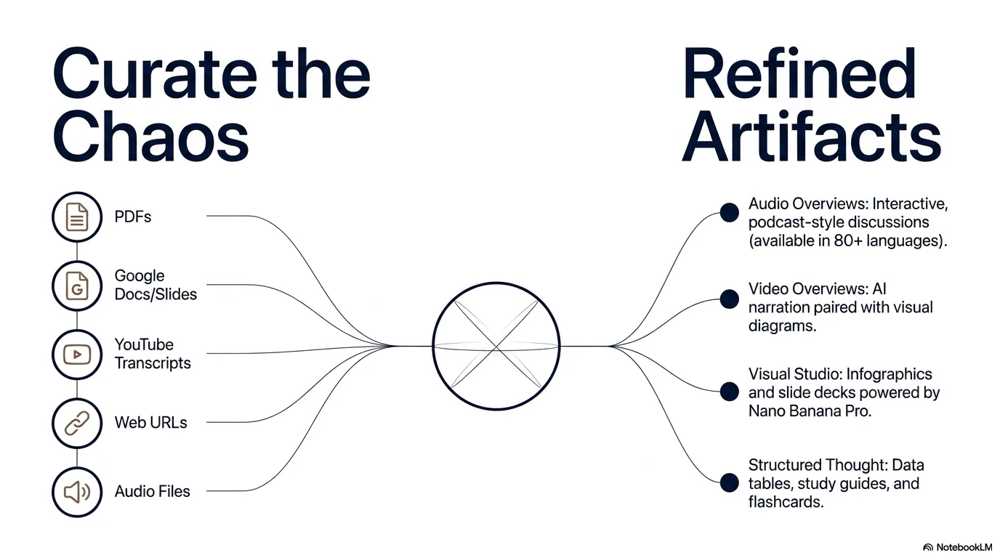

[View Full YAML](styles/slow_living.yaml)

#### Luxe Marble

An ultra-premium and ethereal aesthetic inspired by the purity of white marble and the softness of fine silk. It features the elegant Tenor Sans typeface, which brings a timeless, high-fashion clarity to every slide. Characterized by a palette of bone white, platinum silver, and soft mineral greys, it uses airy layouts and subtle light reflections to create an atmosphere of absolute luxury, exclusivity, and diamond-cut precision.

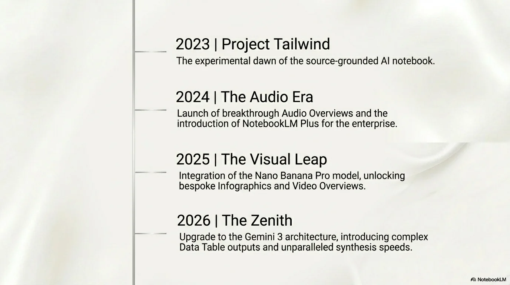

[View Full YAML](styles/luxe_marble.yaml)

### 🎨 Creative & Playful

#### Creative Spark

Vibrant, creative, and high-impact design. Uses a deep dark canvas with neon purple accents, combining elegant script typography with bold, heavy block fonts for maximum contrast.

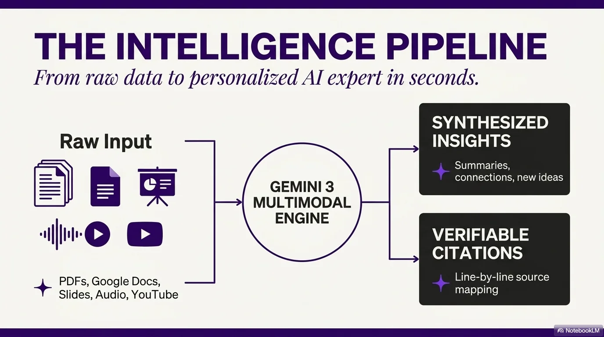

[View Full YAML](styles/creative_spark.yaml)

#### Artisan Rust

Warm, handcrafted, and organic design. Uses a textured rust-colored background with hand-drawn white doodles and tall condensed typography for an artisan feel.

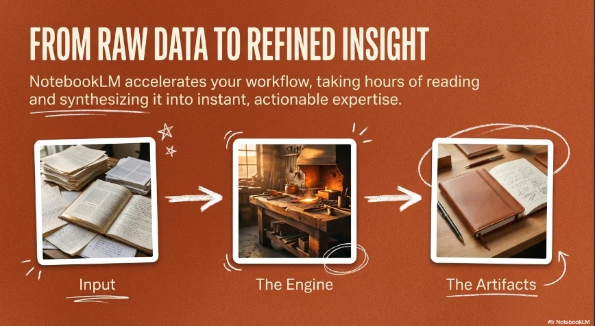

[View Full YAML](styles/artisan_rust.yaml)

#### Vintage Charm

Romantic, nostalgic, and layered design inspired by coquette and scrapbooking aesthetics. It uses pastel tones, torn paper textures, and elegant accents like bows and pearls for a high-jewelry, vintage feel.

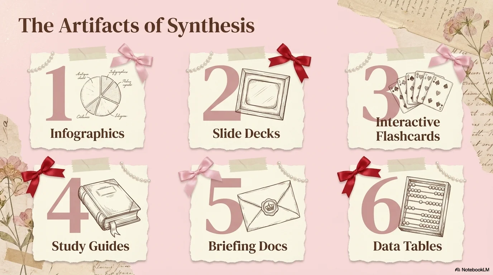

[View Full YAML](styles/vintage_charm.yaml)

#### Creative Notebook

A clean, academic yet playful design inspired by creative journals and student notebooks. It features a graph paper grid background, organic pastel blobs in peach and blue, and numbered list elements for a highly organized yet aesthetic presentation feel.

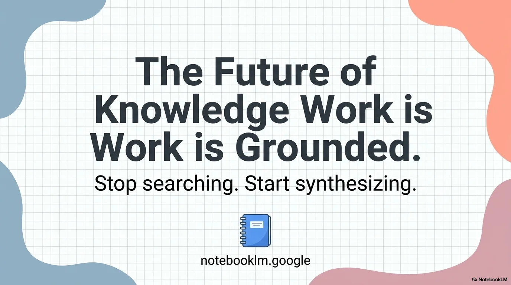

[View Full YAML](styles/creative_notebook.yaml)

#### Kawaii Playful

Playful, friendly, and ultra-cute 'Kawaii' aesthetic. Combines soft pastel colors with chubby cat character illustrations, hand-drawn stars, and notebook-style grid backgrounds.

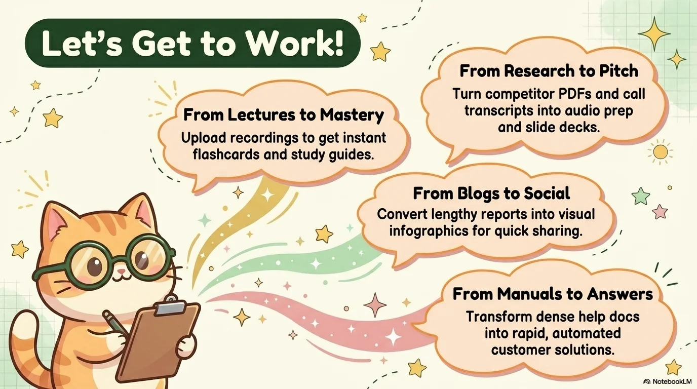

[View Full YAML](styles/kawaii_playful.yaml)

#### Y2K Nostalgia

Bubblegum pop, iridescent textures, and early digital nostalgia. Features CD-ROM reflections, fluffy clouds, and 3D 'plastic' icons (gummy bears, hearts, cupids) on pastel gradients.

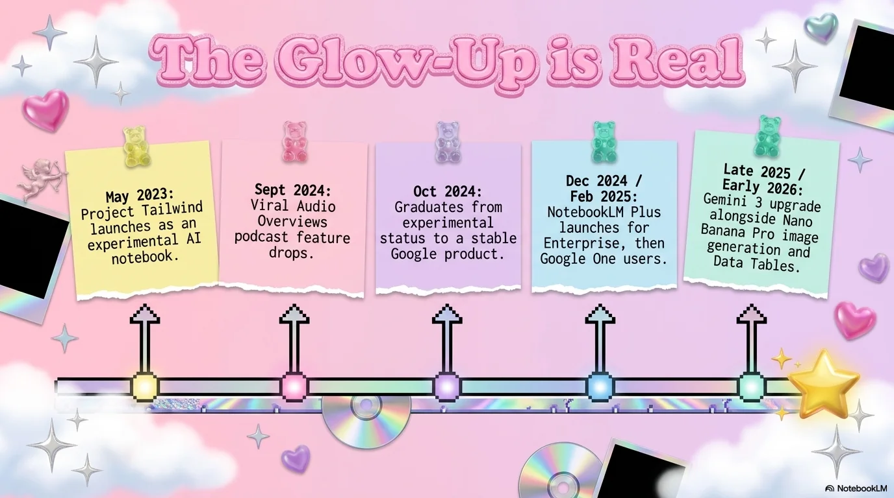

[View Full YAML](styles/y2k_nostalgia.yaml)

#### Creative Workshop

Artistic, youthful, and workshop-oriented design. Features notebook grid backgrounds, pastel pink wavy accents, and friendly 2D art supply doodles (pencils, rainbows, stars).

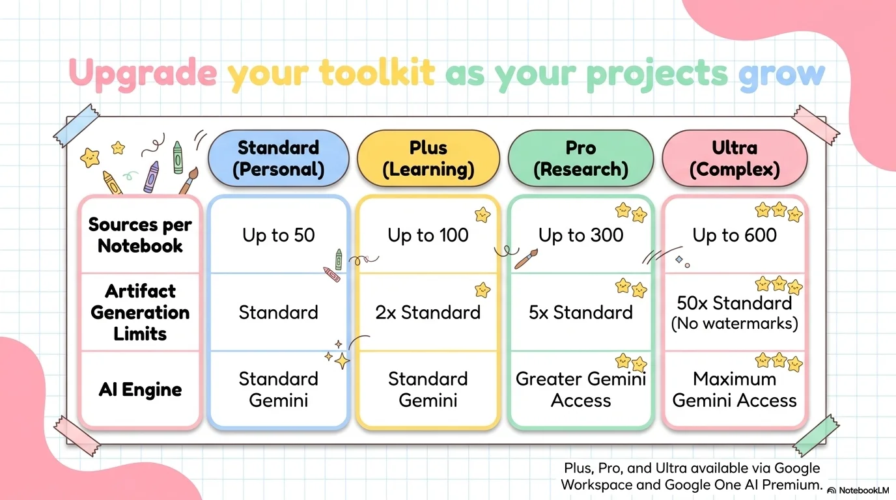

[View Full YAML](styles/creative_workshop.yaml)

#### Creative Classroom

Playful, warm, and educational design. Inspired by primary school classrooms and hand-drawn doodle aesthetics. Features soft cream backgrounds, chalkboard content frames, and flat 2D illustrations of classroom objects.

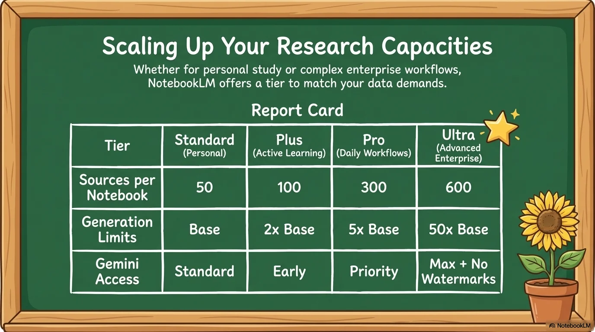

[View Full YAML](styles/creative_classroom.yaml)

#### Hand-Drawn Scrapbook

A whimsical, Kawaii-inspired aesthetic characterized by soft pastel palettes, hand-drawn stickers, and a playful gingham grid. Perfect for educational projects, creative journals, or friendly presentations.

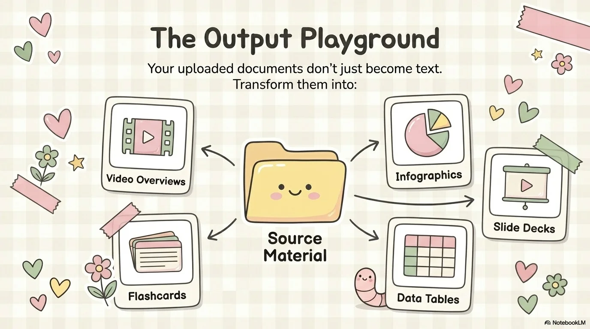

[View Full YAML](styles/hand_drawn_scrapbook.yaml)

#### Whimsical Animation

A sophisticated, animation-inspired portfolio aesthetic. It features a lush palette of forest and lime greens, modern geometric typography, and painterly gouache textures. Ideal for creative professionals looking for a whimsical yet high-end presentation style.

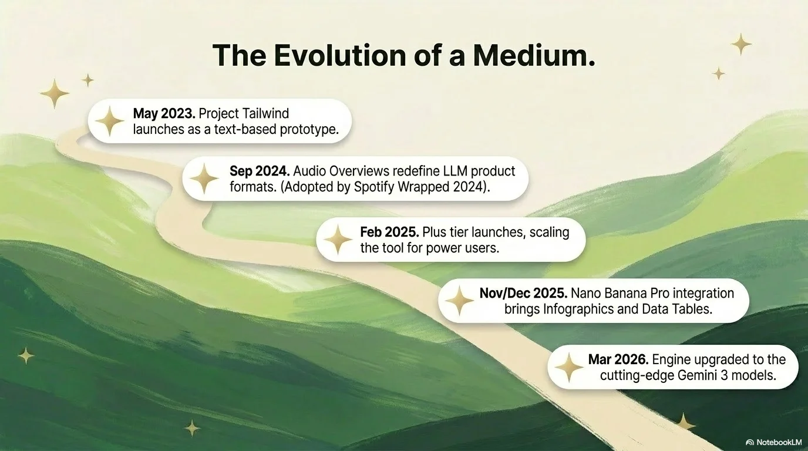

[View Full YAML](styles/whimsical_animation.yaml)

#### Clinical Doodles

An approachable and empathetic medical aesthetic inspired by hand-drawn nursing journals. It features the playful Schoolbell handwriting font, a soft pastel blue palette, and a subtle grid paper texture. Characterized by charming doodle illustrations and organic cloud-like shapes, it humanizes clinical topics.

[View Full YAML](styles/clinical_doodles.yaml)

#### Medicine Pop

A vibrant and high-energy medical aesthetic inspired by pop-art and modern vector illustrations. It features the bold Luktao typeface, a striking palette of deep purple, lavender, and energetic orange over a soft cream background. Characterized by playful medical icons and colorful 'plus' symbols, it brings a fresh and optimistic approach to healthcare data.

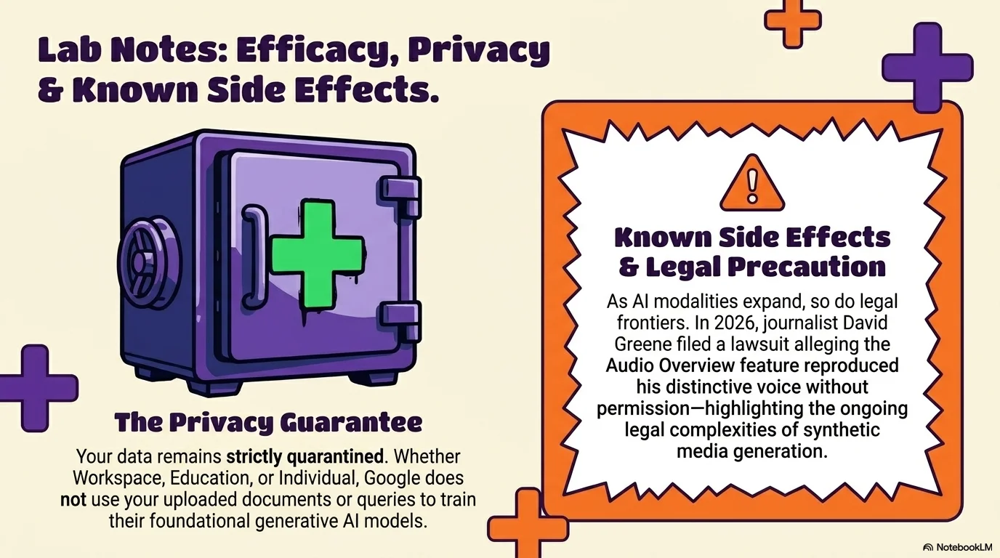

[View Full YAML](styles/medicine_pop.yaml)

#### Garden Doodles

A cozy and organic hand-drawn aesthetic inspired by nature and garden sketches. It features the friendly Mali typeface and a warm palette of terracotta, sage green, and chocolate brown over a soft beige background. Characterized by charming 'doodle' illustrations like smiling suns, flowers, and wooden fences, it brings a personal and approachable touch to any presentation.

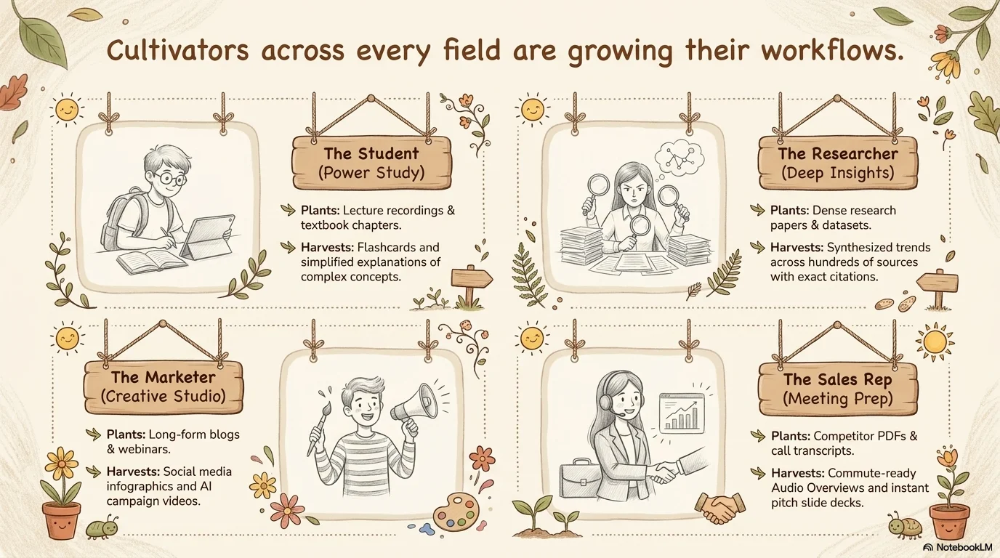

[View Full YAML](styles/garden_doodles.yaml)

#### Kawaii Storybook

An adorable and high-contrast Kawaii aesthetic inspired by children's storybooks. It features the chunky and playful More Sugar typeface over a bright sky blue and meadow green landscape. Characterized by super-cute animal characters (chicks, rabbits, elephants) with rosy cheeks and smiling clouds, it creates a joyful and innocent atmosphere for any presentation.

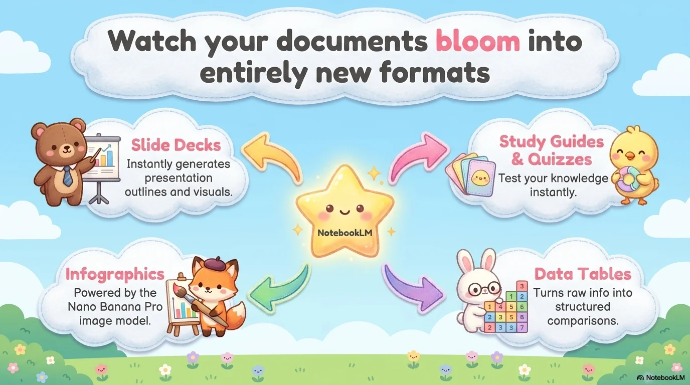

[View Full YAML](styles/kawaii_storybook.yaml)

#### Biochemical Doodles

A creative and educational scientific aesthetic that blends modern biology with hand-drawn doodles. It features the tactile Bobby Jones typeface over a subtly textured paper background. Characterized by charming sketches of DNA helices, beakers, molecules, and organic fluid shapes in muted wine and sage tones, it brings a curious and experimental spirit to any presentation.

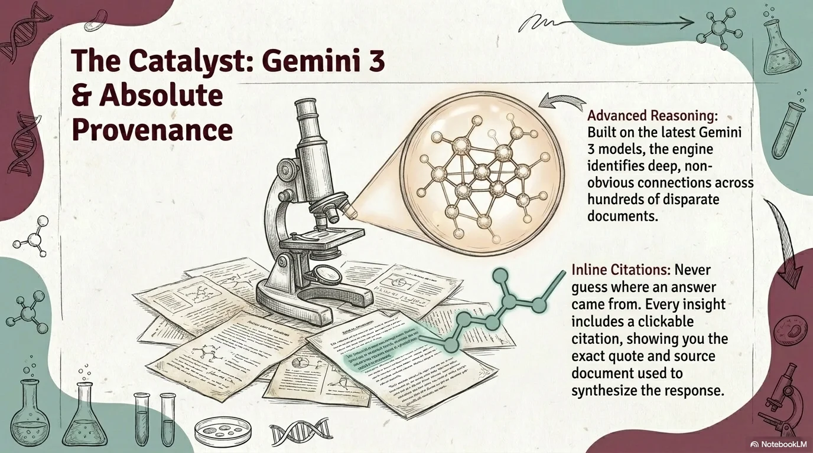

[View Full YAML](styles/biochemical_doodles.yaml)

#### Science Sketch

A clean and vibrant academic aesthetic inspired by high school science projects and textbook sketches. It features the hand-drawn Schoolbell typeface paired with the condensed Pompiere for subtitles. Characterized by thick-lined blue vector doodles filled with bright yellow, and accents like graph paper grids and wavy lines, it conveys a sense of organized learning and active discovery.

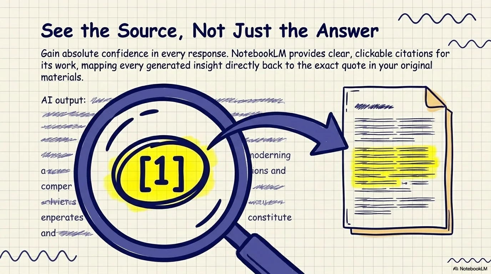

[View Full YAML](styles/science_sketch.yaml)

#### Athletic Energy

A vibrant and motivational aesthetic that celebrates sports and physical activity through a grainy, textured illustration style. It features the massive and blocky Gulfs Display typeface for high-impact headlines. Characterized by energetic salmon and mint green tones, and illustrations of athletes in motion over stippled backgrounds, it brings vitality and a youthful spirit to health and wellness presentations.

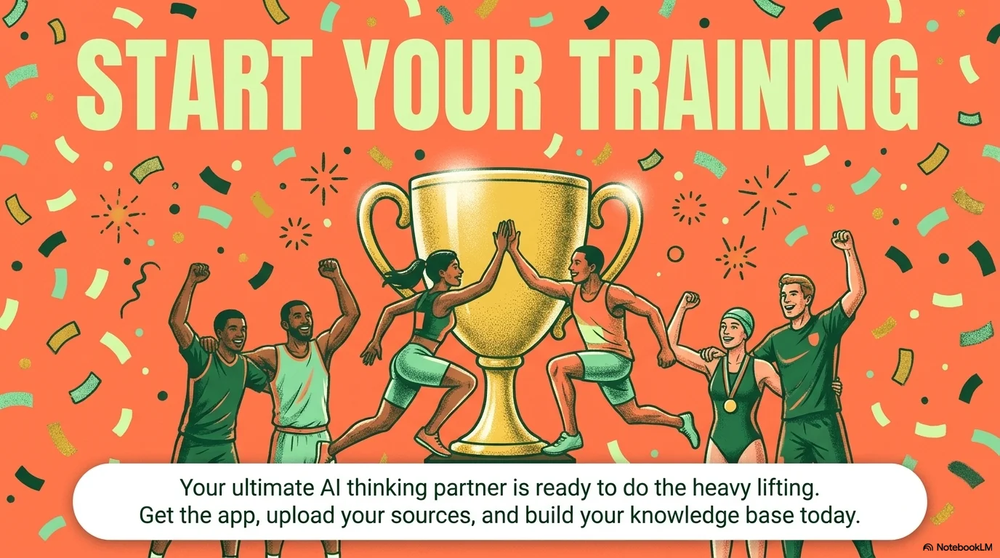

[View Full YAML](styles/athletic_energy.yaml)

#### Kawaii Wellness

An ultra-cute and cheering aesthetic that makes fitness feel approachable and fun. It features the modern TT Firs Neue typeface against a whimsical pastel world. Characterized by adorable chubby characters (kawaii style) engaged in exercises, pink and yellow checkered patterns, and twinkling stars, it brings a sense of joy and sweetness to health and daily movement content.

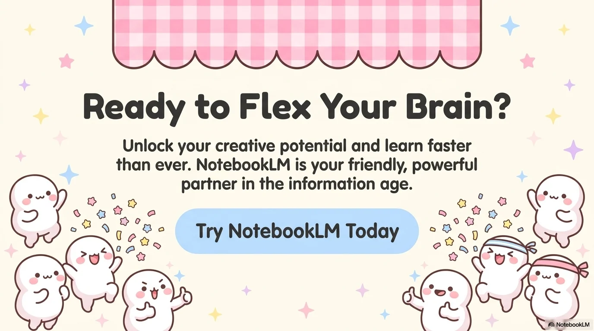

[View Full YAML](styles/kawaii_wellness.yaml)

#### Groovy 70s

A warm and nostalgic aesthetic inspired by the groovy 70s. It features the psychedelic and flowing TAN Nimbus serif for a highly stylized look. Characterized by a cream background with wavy rainbow stripes in burnt orange, mustard yellow, and teal, it uses retro sparkles, flower power icons, and organic heart shapes to create a soulful and stylish atmosphere.

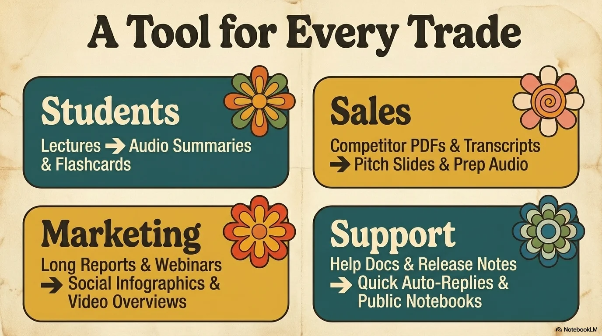

[View Full YAML](styles/groovy_70s.yaml)

#### Kawaii Pop

A vibrant and joyful aesthetic that blends Japanese Kawaii culture with Y2K pop art. It features the playful Genty script for expressive headlines and Hero for clean body text. Characterized by a cream background with pastel pink and yellow accents, it uses halftone patterns, bubbly clouds, and melting shapes to create a personalized and creative atmosphere.

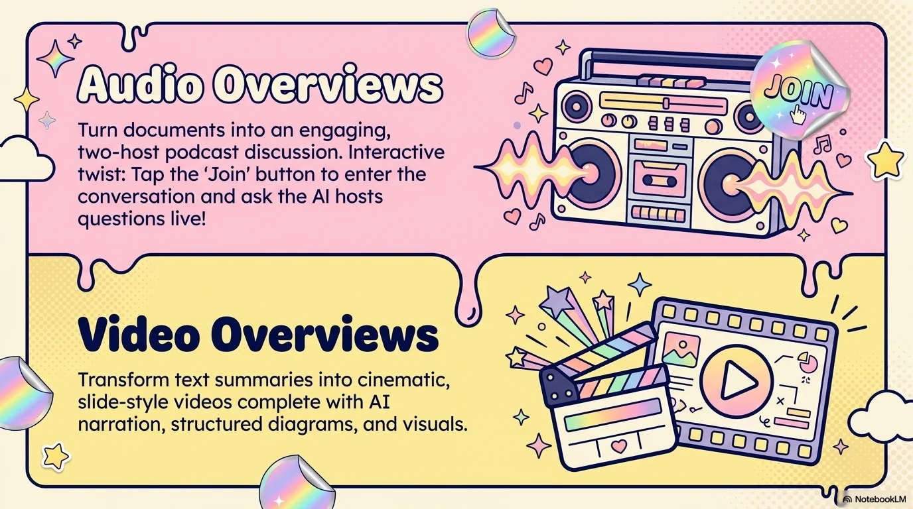

[View Full YAML](styles/kawaii_pop.yaml)

#### Fandom Noir

An elegant and moody aesthetic designed for fandom nights and social games. It pairs the high-contrast Astoria serif with the technical Neue Machina sans-serif. Characterized by a deep black background with soft lavender accents, it features monochrome butterfly motifs, glowing oval portraits, and subtle wavy lines to create a sophisticated yet mysterious community atmosphere.

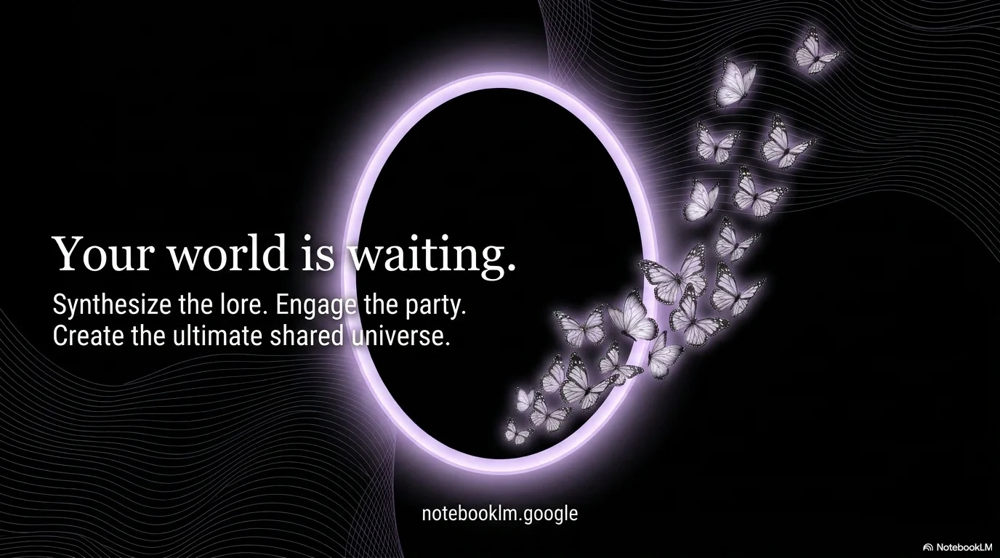

[View Full YAML](styles/fandom_noir.yaml)

#### Sweet Fandom

A charming and cozy aesthetic that transforms social games into a kawaii bakery or tea party experience. It features the friendly KG Primary Penmanship font for a handwritten, approachable feel. Characterized by a palette of pastel pink, mint green, and cream, it uses adorable illustrations of desserts, strawberries, and lemonade jars to create a sweet and playful community atmosphere.

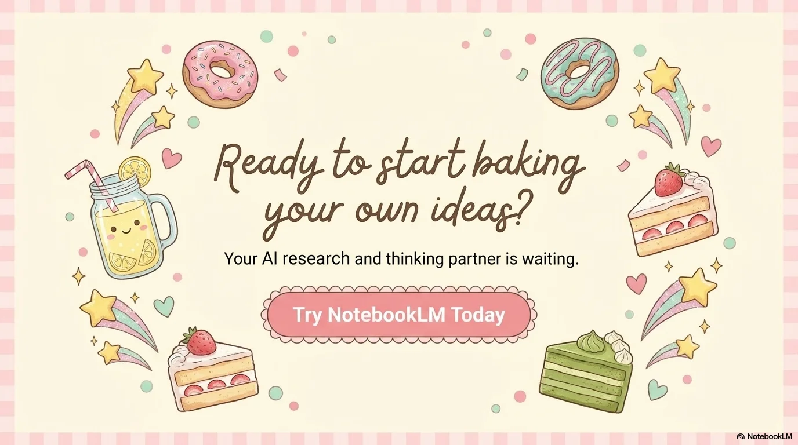

[View Full YAML](styles/sweet_fandom.yaml)

#### Kawaii Fandom

A soft and adorable scrapbook aesthetic designed for K-Pop fandoms and creative community nights. It features the bubbly and hand-drawn More Sugar typeface. Characterized by a palette of pastel blue, pink, and yellow, it uses polaroid frames, cute bear stickers, and hand-drawn doodles to create a fun, youthful, and cozy atmosphere.

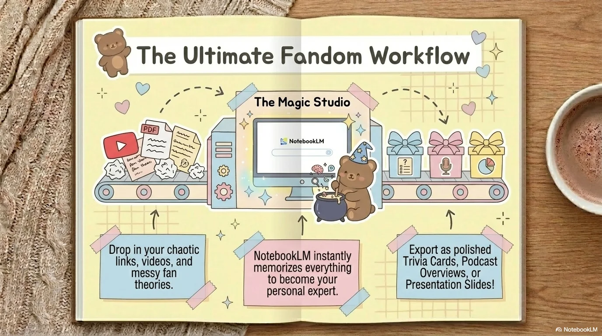

[View Full YAML](styles/kawaii_fandom.yaml)

#### Monster Party

A joyful and high-energy aesthetic designed for anniversaries, celebrations, and playful presentations. It features the clean geometric Open Sauce typeface. Characterized by a white background with vibrant, glowing color blobs, it uses expressive 3D monster characters and floral mascots to create a friendly, modern, and festive atmosphere.

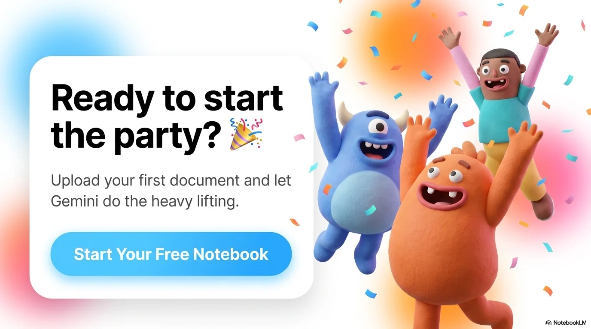

[View Full YAML](styles/monster_party.yaml)

#### Mango Kids

A fun and friendly aesthetic designed for children's games, educational content, and playful group activities. It features the chunky and charismatic Mango AC display font. Characterized by a palette of sky blue, mango yellow, and watermelon pink on cream backgrounds, it uses adorable monster characters with glasses, thick-bordered speech bubbles, and colorful doodle patterns to create a joyful 'kids playroom' atmosphere.

[View Full YAML](styles/mango_kids.yaml)

#### Street Custom

A high-energy and creative aesthetic inspired by urban streetwear and custom product branding. It features the distinctive Fraunces serif for headlines that bridge the gap between classic elegance and modern grit. Characterized by a vibrant palette of electric blue, bright orange, and soft cream, it uses bold brush strokes, organic 'blob' frames, and high-contrast cut-out photography to create a dynamic, youthful, and impactful brand presence.

[View Full YAML](styles/street_custom.yaml)

#### Digital Nomad

A cozy and creative aesthetic designed for digital nomads, remote work culture, and lifestyle storytelling. It features the playful, hand-drawn A Day Without Sun typeface for headlines, bringing a personal and homey touch. Characterized by a palette of soft mint, warm peach, and chocolate brown, it uses charming doodle illustrations of workspace elements, plants, and coffee to create an inviting and imaginative atmosphere.

[View Full YAML](styles/digital_nomad.yaml)

#### Engaging Learner

A fun and engaging aesthetic designed for language learning apps, EdTech startups, and interactive educational presentations. It features the bold Heading Now typeface for titles to convey energy, paired with the friendly clarity of TT Firs Neue. Characterized by a palette of periwinkle blue, soft mint, and coral pink, it utilizes playful speech bubble illustrations, wavy zigzag lines, and hand-drawn style tech icons to create a dynamic and welcoming learning experience.

[View Full YAML](styles/engaging_learner.yaml)

#### Pop Retro

An explosive and high-energy aesthetic inspired by retro-pop and Y2K concert designs. It features the playful Genty script for bold headlines and Genty Sans for readability. Characterized by a vibrant palette of electric magenta and bright yellow, it uses saturated color blocks and large-scale typography to create a dynamic, fun, and musical atmosphere.

[View Full YAML](styles/pop_retro.yaml)

### 📖 Editorial & Magazine

#### Editorial Essence

Sophisticated, editorial, and human-centric design language. It uses warm cream backgrounds, bold terracotta accents, and elegant serif typography to create a "book-like" presentation feel.

[View Full YAML](styles/editorial_essence.yaml)

#### Luxury Editorial

A sophisticated, minimalist aesthetic inspired by high-end fashion magazines. It features a luxury palette of deep espresso and gold, combining elegant condensed serifs with flowing cursive accents. Ideal for luxury brands, fashion collections, and premium product launches.

[View Full YAML](styles/luxury_editorial.yaml)

#### Cobalt Editorial

Bold editorial and Swiss-inspired design. High contrast between Electric Blue and Cream, featuring large brutalist typography, liquid organic textures, and iconic symbols like asterisks and plus signs.

[View Full YAML](styles/cobalt_editorial.yaml)

#### Architectural Portfolio

A modern, minimalist, and geometric design inspired by architectural blueprints and professional portfolios. It features complex pill-shaped photo masks, sage green accents, and a modular "Bento-grid" layout for a high-end, structured aesthetic.

[View Full YAML](styles/architectural_portfolio.yaml)

#### Classical Gallery

A refined, museum-inspired design featuring parchment textures, sage green accents, and elegant ornamental filigree. It balances historical aesthetics with modern sans-serif typography for a scholarly and curated presentation feel.

[View Full YAML](styles/classical_gallery.yaml)

#### Summer Collage

A bright, energetic, and sun-drenched design featuring asymmetric photo grids, breezy handwritten accents, and "Polaroid" style overlays. It creates a vibrant lifestyle atmosphere perfect for travel, leisure, and summer-themed presentations.

[View Full YAML](styles/summer_collage.yaml)

#### Vision Board

A tactile, handmade, and inspirational design featuring realistic paper textures, torn edges, and washi tape accents. It captures the essence of a physical scrapbook or mood board, perfect for creative workshops, personal planning, and visionary presentations.

[View Full YAML](styles/vision_board.yaml)

#### Academic Edge

A sophisticated academic and editorial aesthetic inspired by thesis defenses and research portfolios. It balances high-contrast black and white photography with bold red accents and soft warm 'aura' gradients. Powered by the geometric Codec Pro typeface.

[View Full YAML](styles/academic_edge.yaml)

#### Film Scrapbook

A tactile and nostalgic aesthetic designed for storytelling, biographies, and documentary-style presentations. It pairs the clean Open Sauce sans-serif with the technical Fira Code monospace. Characterized by a charcoal black and cream palette, it features film strip borders, ripped paper textures, and hand-drawn mustard yellow highlights to create a personal, 'behind-the-scenes' scrapbook atmosphere.

[View Full YAML](styles/film_scrapbook.yaml)

#### Soft Editorial

A sophisticated and airy editorial aesthetic designed for fashion campaigns, high-end beauty brands, and feminine storytelling. It features the elegant, high-contrast Loubag serif typeface for headlines, providing a chic and authoritative presence. Characterized by a palette of soft cream, muted lime green, and pale sky blue, it utilizes generous white space, delicate horizontal lines, and pill-shaped category labels to create a premium, magazine-like experience.

[View Full YAML](styles/soft_editorial.yaml)

#### Prime Noir

A dark and sophisticated culinary aesthetic designed for premium steakhouses, fine dining restaurants, and luxury food brands. It features a high-contrast serif for headings to convey tradition and excellence, paired with the modern DM Sans for clear information delivery. Characterized by a matte black background, deep burgundy accents, and delicate botanical illustrations, it creates a prestigious 'noir' dining experience.

[View Full YAML](styles/prime_noir.yaml)

### 🚀 Tech & Innovation

#### Visual Discovery

Focuses on visual-first layouts, card-based components with high border-radius, and vibrant red accents to drive engagement and focus. Inspired by modern discovery feeds.

[View Full YAML](styles/visual_discovery.yaml)

#### Urban Ribbon

An authoritative and structured corporate aesthetic featuring distinctive 3D-folded "ribbon" elements and sharp diagonal background slices. It combines a professional charcoal and beige palette with golden-hour cityscape photography, creating a sense of metropolitan sophistication and executive power.

[View Full YAML](styles/urban_ribbon.yaml)

#### Neon Pulsar

Futuristic, high-energy, and tech-focused design. This dark mode aesthetic uses vibrant neon gradients (Cyan, Magenta, Purple) and glassmorphic elements to create a cutting-edge startup atmosphere.

[View Full YAML](styles/neon_pulsar.yaml)

#### Midnight Tactical

Modern, tech-utilitarian design with a high-contrast matte black base and vibrant lime green accents. Features industrial aesthetic elements like tilted boxes, double chevrons, and monospace metadata.

[View Full YAML](styles/midnight_tactical.yaml)

#### Architectural Mono

Modern brutalist, monochromatic, and architectural design. Inspired by minimalist gallery aesthetics, it features high-contrast grayscale photography, large technical stamps, and sleek sans-serif typography.

[View Full YAML](styles/architectural_mono.yaml)

#### Architectural Cobalt

Technical, dark architectural, and blueprint-inspired design. Features deep charcoal backgrounds with vibrant cobalt blue gradients and precise 'sight' crosshair visual elements for a high-end engineering feel.

[View Full YAML](styles/architectural_cobalt.yaml)

#### Startup Aura

A high-end, tech-focused pitch deck aesthetic. It features soft 'mesh' gradients in blue tones, clean Open Sauce typography, and a professional dark-mode charcoal base. Designed for startups, product launches, and innovative business presentations.

[View Full YAML](styles/startup_aura.yaml)

#### Neon Venture

A bold, futuristic startup aesthetic that blends deep indigo backgrounds with vibrant neon lavender accents. It features iridescent 3D geometric shapes, glassmorphism UI elements, and dynamic vertical typography. Perfect for high-tech ventures, AI startups, and forward-thinking pitches.

[View Full YAML](styles/neon_venture.yaml)

#### Cyber Pixel

A vibrant and nostalgic aesthetic inspired by 8-bit gaming and retro-tech culture. It features the pixelated Pixelion typeface to capture the essence of vintage computing. Characterized by a dark purple and cyan neon palette, it uses icons of floppy disks, cassettes, and pixel hearts, all enhanced with glow effects and floating bubbles to create a futuristic synthwave atmosphere.

[View Full YAML](styles/cyber_pixel.yaml)

#### Project Launch

An energetic and professional aesthetic designed for tech launches, project kick-offs, and collaborative workshops. It pairs the elegant The Youngest serif with the bold Heading Now sans-serif. Characterized by high-contrast blocks of blue, orange, and magenta, it features sketchy, hand-drawn style illustrations of people and workspace elements to create a dynamic 'startup' atmosphere.

[View Full YAML](styles/project_launch.yaml)

#### Tech Pitch

A high-energy and futuristic pitch deck aesthetic designed for tech startups, innovation hubs, and venture capital presentations. It features the bold and technical Open Sauce typeface for maximum impact and modern clarity. Characterized by a matte black background, vibrant neon lime green accents, and grayscale photography, it utilizes sharp geometric lines, minimalist charts, and punchy typography to create a powerful and forward-thinking visual presence.

[View Full YAML](styles/tech_pitch.yaml)

#### Prismatic Tech

An ultra-clean and futuristic aesthetic designed for high-tech product launches, software architecture, and innovation-focused presentations. It features the wide and impactful Agrandir Extended typeface for titles, paired with the regular Agrandir for clarity. Characterized by a pure white background with prismatic and holographic accents, it utilizes 3D iridescent crystal illustrations, thin technical UI lines, and crop mark corners to create a sophisticated, high-performance visual experience.

[View Full YAML](styles/prismatic_tech.yaml)

#### Cyber AI

A high-impact and nocturnal aesthetic designed for AI research, cybersecurity, and cyberpunk-themed tech presentations. It features the blocky and futuristic Pattanans typeface for titles to convey a digital frontier feel, paired with the modern Montserrat for readability. Characterized by a deep midnight blue background with vibrant neon purple and cyan accents, it utilizes 3D glowing robot illustrations, isometric UI modules, and floating star effects to create an immersive digital future experience.

[View Full YAML](styles/cyber_ai.yaml)

### 🌿 Nature & Wellness

#### Eco Modern

A modern, sustainable, and high-impact aesthetic inspired by nature and environmental initiatives. It features immersive landscape photography, dark mode backgrounds, and glassmorphic (frosted glass) overlays. A signature lime-green accent dot provides a contemporary brand finish.

[View Full YAML](styles/eco_modern.yaml)

#### Botanical Journal

Eco-friendly, natural, and scrapbook-inspired design. Features hand-drawn botanical doodles (leaves, vines, flowers), washi tape accents, and torn notebook paper textures on a warm cream background.

[View Full YAML](styles/botanical_journal.yaml)

#### The Seasons

An organic and earthy aesthetic inspired by sustainable branding, apothecary, and wellness. It features high-contrast serifs, deep olive and terracotta tones, and botanical photography with stadium-shaped masks and balanced asymmetric layouts.

[View Full YAML](styles/the_seasons.yaml)

#### Scholar's Journal

Academic, vintage, and scientific design. Inspired by 19th-century botanical engravings and researcher journals. It features heavy coarse paper textures and deep indigo line art illustrations for a scholarly feel.

[View Full YAML](styles/scholars_journal.yaml)

#### Classical Scrapbook

A tactile, layered design that blends classical art history with a handcrafted scrapbook aesthetic. It features overlapping kraft paper and parchment textures, torn edges, washi tape accents, and elegant flowing script combined with classic serif typography.

[View Full YAML](styles/classical_scrapbook.yaml)

#### Vibrant Agency

A high-energy, playful aesthetic inspired by modern marketing and creative agencies. It features vibrant orange "bubble" elements, wavy dividers, and friendly bold typography. Perfect for pitches that need to convey enthusiasm and creative momentum.

[View Full YAML](styles/vibrant_agency.yaml)

#### Vitality Glow

An energetic and fresh aesthetic focused on health, wellness, and vitality. It features the friendly Poppins typeface, vibrant lime green and bright blue accents, and dynamic diagonal shapes. Perfect for wellness coaching, sports nutrition, and preventive healthcare presentations.

[View Full YAML](styles/vitality_glow.yaml)

#### Modern Wellness

A sleek and professional aesthetic for contemporary health and lifestyle content. It utilizes the geometric TT Firs Neue typeface to convey precision and modernity. Featuring a balanced palette of deep slate, forest green, and amber orange, it combines clean photography with minimalist vector shapes and ample white space for a premium corporate wellness feel.

[View Full YAML](styles/modern_wellness.yaml)

#### Deep Forest

A majestic and immersive aesthetic designed for environmental conservation, ecology, and deep nature topics. It features the geometric Garet typeface. Characterized by a palette of deep forest greens, charcoal, and moss, it uses high-contrast white text over foggy forest photography to create a professional, scientific, and atmospheric editorial look.

[View Full YAML](styles/deep_forest.yaml)

#### Urban Jungle

A fresh and organic aesthetic designed for urban gardening and botanical pitch decks. It combines the modern Agrandir and Poppins typefaces for a clean, professional look with a friendly touch. Characterized by soft beige backgrounds, vibrant moss green accents, and iconic Monstera leaf decorations, it creates a sophisticated yet growth-oriented atmosphere for plant-centric content.

[View Full YAML](styles/urban_jungle.yaml)

#### Modern Farm

A robust and contemporary aesthetic that merges industrial agriculture with modern business design. It features bold Agrandir headlines and clean Poppins body text. Characterized by a striking palette of deep barn red and olive green, it uses rounded photography of farm life, daisy icons, and high-contrast color blocks to create a grounded yet professional atmosphere.

[View Full YAML](styles/modern_farm.yaml)

#### Sustainable Agri

A clean and data-driven aesthetic for the future of farming and sustainable technology. It utilizes the neutral Canva Sans typeface to prioritize content clarity. Characterized by a monochrome palette of lush greens—from deep forest to vibrant lime—it features aerial crop photography, semi-transparent overlays, and structured roadmaps for a professional agro-tech feel.

[View Full YAML](styles/sustainable_agri.yaml)

#### Modern Harvest

A premium and innovation-focused aesthetic for modern agriculture. It uses the friendly and geometric Garet typeface to present data-driven solutions. Characterized by a clean white background with sophisticated terracotta and deep earth tones, it features ultra-rounded image containers and high-end rural photography to create a trustworthy, high-tech farming atmosphere.

[View Full YAML](styles/modern_harvest.yaml)

#### Mindful Aura

A calm and ethereal aesthetic designed for wellness, mindfulness, and mental health presentations. It features the elegant and clear Raleway typeface. Characterized by a palette of soft lavender and deep purples on pure white backgrounds, it uses radiant light beams, aura-like gradients, and floral geometric patterns to create a serene, therapeutic, and professional atmosphere.

[View Full YAML](styles/mindful_aura.yaml)

#### Botanical Harmony

A warm and organic aesthetic inspired by folk art and botanical illustrations. It features the calligraphic 29LT Riwaya typeface. Characterized by an earthy palette of cream, sand, and taupe, it uses fine line-art of mountains, butterflies, and sun motifs to create a human, artisanal, and deeply serene atmosphere for wellness and nature topics.

[View Full YAML](styles/botanical_harmony.yaml)

#### Yoga Glow

A gentle and maternal aesthetic designed for prenatal yoga, mindfulness, and conscious movement. It uses the clean Open Sauce typeface paired with soft, hand-drawn 'chalky' cloud outlines. Characterized by a soothing palette of sage greens and off-whites, it features flat illustrations of yoga poses and grainy textures to create a safe, nurturing, and calm atmosphere.

[View Full YAML](styles/yoga_glow.yaml)

#### Misty Forest

A majestic and immersive aesthetic designed for environmental conservation, ecology, and deep nature topics. It features the geometric Garet typeface. Characterized by a palette of deep forest greens, charcoal, and moss, it uses high-contrast white text over foggy forest photography to create a professional, scientific, and atmospheric editorial look.

[View Full YAML](styles/misty_forest.yaml)

#### Serum Essence

A serene and sophisticated aesthetic designed for premium skincare, beauty, and wellness editorial content. It features the exquisite TAN Mon Cheri serif for headlines, bringing a touch of high-fashion elegance. Characterized by a palette of warm amber, soft cream, and muted lavender, it uses frosted glass textures, organic shadows, and macro photography of liquid textures to create a calming and professional atmosphere.

[View Full YAML](styles/serum_essence.yaml)

#### Artisanal Bloom

A warm and organic aesthetic inspired by artisanal floriculture and botanical heritage. It features the flowing Bakerie script for headlines and the clean, modern TT DRUGS for body text. Characterized by a sun-drenched palette of ochre, golden yellow, and warm beige, it uses fine-line botanical illustrations, circular framing, and elegant timeline layouts to create a sense of growth, quality, and natural beauty.

[View Full YAML](styles/artisanal_bloom.yaml)
<!-- STYLES:END -->

---

## 🚀 How to Use

1. Pick a style and copy its YAML (use the **Copy** button on the [website](https://www.slidestyleshub.com/) or open the *View Full YAML* link).
2. Paste it into your NotebookLM prompt or configuration when generating slides.
3. Enjoy your beautifully styled presentation!

## 🛠️ Contribution

Feel free to add more styles by following our [Contribution Guide](CONTRIBUTING.md).

---

## 🏗️ Acknowledgements

Preview images in this repository and on the showcase website are generated using **NotebookLM's Slide Decks** feature.

This project is made possible by:

- **Vercel** (Hosting & Platform)
- **Social Icons:** [thesvg.org](https://www.thesvg.org/)
- **NotebookLM** (AI Presentation Engine)
- **Gemini** (AI Foundation)
- **Antigravity** (AI Engineering Assistant)

---

## ⚖️ Disclaimer

**NotebookLM Prompt Styles** is an independent, community-driven project and is **not affiliated with, endorsed by, or associated with Google LLC or the official NotebookLM team.** "NotebookLM" and its logo are trademarks of Google LLC.

While these prompts are optimized for NotebookLM's Slide Decks feature, the YAML styles and aesthetic configurations are highly versatile and can be effectively used with **other similar AI image and presentation generation tools** (like Midjourney, DALL-E, Canva Magic Design, etc.) that accept structured style inputs.

